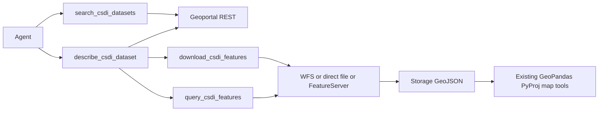

# CSDI Portal tools for GIS-MCP

CSDI Portal ([portal.csdi.gov.hk](https://portal.csdi.gov.hk/)) is Hong Kong Lands Department’s Common Spatial Data Infrastructure: 1,100+ datasets behind an [Esri Geoportal Server](https://github.com/Esri/geoportal-server-catalog) catalogue, with features served by OGC WFS, OGC WMS, ArcGIS REST, and direct file links. The Data Query Service was discontinued on 30 June 2026, so new tools should not call it.

GIS-MCP already does analysis and mapping. New tools should only find a dataset and save features as a file. After that, existing tools take over: `read_file_gpd`, `clip_vector`, `sjoin_gpd`, `transform_coordinates`, and the map tools. Do not add one tool per dataset, and do not reimplement buffer, overlay, or reprojection.

## Catalogue: Geoportal REST, not CSW

Use the Geoportal REST catalogue. CSW at `https://portal.csdi.gov.hk/geoportal/csw` is the same Geoportal index exposed as XML (`GetRecords` even accepts the Geoportal `q` parameter). It is the interface the public docs advertise, and it is the worse client for an agent:

- The REST item and search JSON already include `title`, `description`, publisher, keywords, and `bbox` as `xmin,ymin,xmax,ymax` in WGS84 longitude/latitude order. CSW returns the same facts as ISO 19139 XML.
- A live item (`/geoportal/rest/metadata/item/{id}`) carries typed distributions in `_source.resources_nst`, for example FeatureServer, WFS `GetCapabilities`, WMS `GetCapabilities`, and `geojson` file links. CSW would require parsing `CI_OnlineResource` out of the metadata XML to recover those URLs. Datasets such as iGeoCom have direct GeoJSON/CSV links and no WFS at all, so the typed list is what tells the downloader which path exists.
- The bbox contract matches the rest of GIS-MCP. CSW 2.0.2 with `EPSG:4326` uses latitude/longitude axis order.

Do not call the raw Elasticsearch proxy `/geoportal/elastic/*`, and do not search with a plain `q=` parameter. The portal search button does not do that either. Its catalogue page posts the query built by `getESQuery` in [app/etc/util.js](https://portal.csdi.gov.hk/geoportal/app/etc/util.js). A plain `q=building` ranks “GeoCommunity Database iGeoCom” first with a flat `_score` of 2. The same word through `getESQuery` ranks “Building Licence” (44.0) and “Building” (43.2) first. POST that query body to `/geoportal/rest/metadata/search?f=json-source`; a live call returned the same order and scores as the portal’s elastic proxy, without using the proxy. Reimplement `getESQuery` in Python. Do not vendor the portal JavaScript.

Endpoints:

- Search: `https://portal.csdi.gov.hk/geoportal/rest/metadata/search`
- Item: `https://portal.csdi.gov.hk/geoportal/rest/metadata/item/{id}`

Accept either the portal dataset id (`td_rcd_1638844988873_41214`, the Elasticsearch `_id`) or the metadata `fileid` UUID. Both resolve on the item endpoint.

Strip `sys_xml_clob`, `sys_xmlmeta_obj`, owner emails, and access-group ids before any tool result. The live JSON includes the full ISO XML even when `includeMetadata` is not requested, and that blob will flood the model context. Also drop `_source` from search hits; the summary object is enough. Fetch the item only in `describe_csdi_dataset`.

`requests` is the only new dependency. Drop `owslib` from the extra.

## Recommended tools

Put them in a new optional extra `gis-mcp[csdi]`, registered like the other gatherers in [src/gis_mcp/main.py](src/gis_mcp/main.py), with a resource `gis://operations/csdi`. Follow the same return shape as [src/gis_mcp/data/administrative_boundaries.py](src/gis_mcp/data/administrative_boundaries.py): `{"status", "file_path"}` or `{"status", "message"}`, and write under the storage root (`csdi/` by default).

- **`search_csdi_datasets`** — POST `/geoportal/rest/metadata/search?f=json-source` with the portal search-bar query, not `q=`. Arguments: `q`, optional `bbox` (`xmin,ymin,xmax,ymax`, WGS84), `spatial_rel` (`intersects` or `within`), `num`, `start` (1-based), optional `sort`. Build the Elasticsearch `bool` query the way `getESQuery` does:

  - Search `apiso_Title_txt^10`, `keywords_txt^2`, `apiso_Abstract_txt`, `apiso_OrganizationName_txt`, `apiso_Subject_txt`, and `apiso_Lineage_txt`.
  - A quoted phrase is an exact `query_string` on those fields.
  - `&` sets `default_operator` to `AND`; otherwise it is `OR`, with `fuzziness: AUTO`.
  - A term prefixed with `-` goes in `must_not`.
  - `*` uses the portal wildcard form: the term plus `*term*` on `*` and the title and keyword fields.

  Return `total`, `next_start`, `sort` (`relevance` when omitted), and a short list: `rank` (1-based across the full result), `score` (Elasticsearch `_score`, null when `sort` is set), id, title, description, publisher, keywords, bbox. Allowlist those fields from `_source` and drop `sys_xml_clob`. The typeahead endpoint `/csdi-webpage/searchDataset` is only the short suggestion list (datasets, categories, and providers, no score or paging). Its top datasets for “building” match this query, so the tool uses the full ranked query instead of the typeahead.

- **`describe_csdi_dataset`** — GET `/geoportal/rest/metadata/item/{id}`. Returns title, bbox, CRS, and the distributions classified from `resources_nst` and `links_s`: WFS, WMS, FeatureServer, and direct files (GeoJSON, CSV, FGDB). Then call WFS `GetCapabilities` and `DescribeFeatureType` when a WFS link exists, so the result also includes `typeNames`, geometry type, and fields. An agent needs this before it can query, because each dataset has its own MapServer path and type name.

- **`download_csdi_features`** — Save features for a dataset id. If the caller passes no bbox and the item has a direct GeoJSON (or CSV) link, download that file. Otherwise use WFS 2.0 `GetFeature` with `outputFormat=GeoJSON`. Arguments: dataset id, optional type name, bbox, `crs`, `count` (portal maximum 10,000), `start_index`, optional `path`. Writes a file and returns the path, feature count, columns, and a few property samples. Geometry stays on disk. `result_type="hits"` returns only the WFS match count so an agent can check size before paging.

- **`query_csdi_features`** — ArcGIS FeatureServer `/query` for attribute filters. The published WFS parameter list has bbox and paging, not a property filter. This tool takes `where`, optional envelope, `in_sr` / `out_sr`, `out_fields`, and `return_count_only`, and writes GeoJSON the same way. Use it when the question is “district = TW” rather than “everything in this bbox”. The FeatureServer URL comes from `resources_nst`, not from a guessed path.

## CRS and bbox behavior

Catalogue bbox is already `xmin,ymin,xmax,ymax` in WGS84. Feature bbox uses the same order plus a CRS, default `EPSG:4326` in longitude/latitude. Convert internally to the WFS 2.0 axis order for `EPSG:4326` (latitude, longitude), which is what the portal’s own WFS example uses. Default saved files to `EPSG:4326` so GeoPandas and Shapely can read them; allow `EPSG:2326` (Hong Kong 1980 Grid) as an output CRS. Existing `transform_coordinates` covers any other target.

## What to leave out

- CSW `GetRecords` / `GetRecordById`, and the `/geoportal/elastic/*` proxy.
- WMS `GetMap`. It returns a picture, not features the analysis tools can join. The describe tool still reports the WMS URL.
- DQS.
- A curated “buildings / lots / addresses” tool list. The catalogue already names those datasets.

## Implementation checklist

- Add `src/gis_mcp/data/csdi.py` with the four tools, Geoportal REST plus WFS/ArcGIS/file clients, CRS axis-order handling, and storage writes.
- Register the module in `main.py` and add the `gis-mcp[csdi]` extra (`requests` only) in `pyproject.toml`.
- Document the tools under `docs/data-gathering` and add tests with recorded Geoportal, WFS, and ArcGIS responses.
